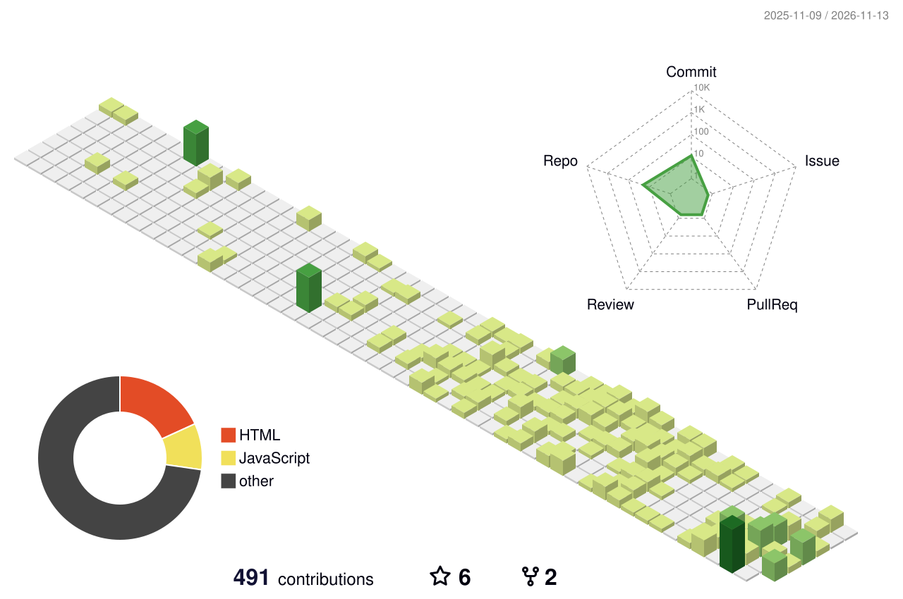

<h1 align="center">Hi, I'm Anmol 👋</h1>
<h3 align="center">Product Engineer from India. I design, build and ship software that solves real business problems.</h3>

  <b>Mobile</b> · <b>Web</b> · <b>Desktop</b> · <b>Backend</b> · <b>Interface Design</b> · <b>Automation</b>

  
  
  

  

## About Me

I'm a self-taught product engineer. I started with Python in 2015, pushed my first public code in 2017, and have been building software professionally since 2022. Right now I'm the **Lead Mobile App Developer at Elxer Communications**, where I'm the only mobile engineer and own two Flutter products end to end.

I like owning the whole problem, not just one layer of it: shaping the flow in Figma, building the app on mobile, web or desktop, wiring up the backend, shipping the release and automating the boring parts. I care most about software that holds up under real use, not software that only looks finished in a demo.

- 📱 Building production Flutter apps that field teams and customers use every day
- 🌐 Shipping my own web products with Next.js, TypeScript and WebGL
- ✍️ Writing about real production problems on my [blog](https://blog.anmolthedeveloper.com)
- 🤝 Open to select freelance and collaboration work: [anmolthedeveloper.com](https://www.anmolthedeveloper.com)

## What I Build

| | |
| :-- | :-- |
| 📱 **Mobile apps** | Flutter apps with offline-first data, payments, background location, native platform channels and Play Store releases |
| 🌐 **Web apps** | Next.js products, admin panels, dashboards, REST APIs and in-browser tools |
| 🖥️ **Desktop tools** | Electron apps with per-machine licensing, code signing, notarisation and auto-update |
| 🎨 **Product & interface design** | Figma flows, design systems and clickable prototypes before a line of code |
| ⚙️ **Backend & infra** | Node/NestJS services on Postgres, Dockerised and deployed behind Nginx with CI/CD |
| 🤖 **Automation** | Scripts, integrations, scheduled jobs and reporting that save teams hours |
| ⚡ **Performance** | Finding the slow part and making it fast |

## Selected Wins

- ⚡ Cut image-to-location processing from **~26 seconds to 1–2 seconds** by replacing a slow third-party package
- 💸 Removed a **paid location-tracking SDK licence** by building the tracking in-house
- 📍 Built location tracking that **keeps running after the app is killed**, used daily by **100+ employees**
- 🧱 Moved a production codebase to **Clean Architecture + MVVM** to ship features faster
- 🏆 **1st place**, Flutter Hackathon by Effcon Technologies (2021)

## Featured Work

**Shipped products**

| Project | What it is | Focus |
| :-- | :-- | :-- |
| [**ElxerOne**](https://www.anmolthedeveloper.com/work/elxerone) | Enterprise field-operations platform used daily by 100+ employees | Flutter · Background location · Security |
| [**MyElxer**](https://www.anmolthedeveloper.com/work/myelxer) | Consumer ISP app, rebuilt from scratch | Flutter · Payments · Self-service · PDF |
| [**WA Services**](https://www.anmolthedeveloper.com/work/wa-services) | Desktop product for running WhatsApp automation, licensed per machine | Desktop · Licensing · Release engineering |
| [**Happy Staff**](https://www.anmolthedeveloper.com/work/happy-staff) | Staff productivity analytics (freelance) | Productivity · Analytics |
| [**K_Dictionary**](https://www.anmolthedeveloper.com/work/k-dictionary) | Offline-first, cross-platform dictionary | Cross-platform · Offline-first |

**Workbench: things I build for fun and ship anyway**

| Project | What it is | Stack |
| :-- | :-- | :-- |
| [**Mockdrop**](https://mockdrop.developerbros.com) | 3D device mockups and video export, right in the browser | Next.js · React Three Fiber · ffmpeg.wasm · NestJS · Postgres |
| [**ClipForge**](https://clipforge.developerbros.com) | Video and audio editor that runs fully in the browser, no uploads, no accounts | Next.js · Web Audio · TypeScript |
| [**MetaPure**](https://metapure.anmolthedeveloper.com) | Strips location, device and watermark data from photos | Next.js · TypeScript · EXIF |
| [**ColorTheory**](https://color-theory.anmolthedeveloper.com) | Interactive colour theory reference | Next.js App Router · TypeScript |
| **Lottie Studio** | Lottie animation editor on a custom animation engine, no animation library | Next.js · React 19 · TypeScript |

Also shipped: **Sanghathit**, a social app with real-time audio/video calling (live on Google Play), an e-commerce app with payments, an attendance app with photo verification and device binding, and an Android TV app that streams RTSP cameras.

More case studies on [anmolthedeveloper.com](https://www.anmolthedeveloper.com).

## Tech Stack

I pick the tool that fits the problem. These are the ones I've shipped real work with:

| Area | Tools |
| :-- | :-- |
| **Mobile** |        |
| **Web** |        |
| **Backend & Realtime** |         |
| **Desktop & DevOps** |        |
| **Design & More** |      |

Plus the unglamorous parts that make a product actually work: platform channels, offline-first sync, payment gateways, background services, code signing and notarisation, auto-update, CI/CD and VPS deployments.

## Latest From My Blog

I write about production Flutter: fake GPS detection, app lifecycle, platform channels, CustomPaint and real debugging stories.

<!-- BLOG-POST-LIST:START -->
- [Tracking From the Grave: How Apps Follow Your Location After They're Killed](https://blog.anmolthedeveloper.com/tracking-from-the-grave-how-apps-follow-your-location-after-they-re-killed)
- [How to Open-Source Your Flutter Plugin and Still Hide the Code That Pays You](https://blog.anmolthedeveloper.com/how-to-open-source-your-flutter-plugin-and-still-hide-the-code-that-pays-you)
- [You Built It Once. Now Sell It a Hundred Times: The Complete Flutter App Rebranding Guide](https://blog.anmolthedeveloper.com/you-built-it-once-now-sell-it-a-hundred-times-the-complete-flutter-app-rebranding-guide)
- [Flutter Theme Guide: Light Mode, Dark Mode, System Theme and Custom Brand Colors](https://blog.anmolthedeveloper.com/flutter-theme-guide-light-mode-dark-mode-system-theme-and-custom-brand-colors)
<!-- BLOG-POST-LIST:END -->

➡️ [Read all articles](https://blog.anmolthedeveloper.com)

## GitHub Activity

  <picture>
    <source media="(prefers-color-scheme: dark)" srcset="https://raw.githubusercontent.com/anmolthedeveloper/anmolthedeveloper/HEAD/profile-3d-contrib/profile-night-rainbow.svg" />
    <source media="(prefers-color-scheme: light)" srcset="https://raw.githubusercontent.com/anmolthedeveloper/anmolthedeveloper/HEAD/profile-3d-contrib/profile-green-animate.svg" />
    
  </picture>

  <picture>
    <source media="(prefers-color-scheme: dark)" srcset="https://raw.githubusercontent.com/anmolthedeveloper/anmolthedeveloper/output/github-snake-dark.svg" />
    <source media="(prefers-color-scheme: light)" srcset="https://raw.githubusercontent.com/anmolthedeveloper/anmolthedeveloper/output/github-snake.svg" />
    
  </picture>

## Connect With Me

  
  
  
  
  
  
  
  

<i>Have a problem worth solving? Let's talk: <a href="https://www.anmolthedeveloper.com">anmolthedeveloper.com</a></i>

